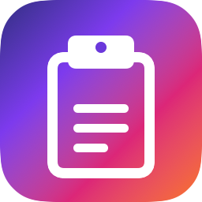
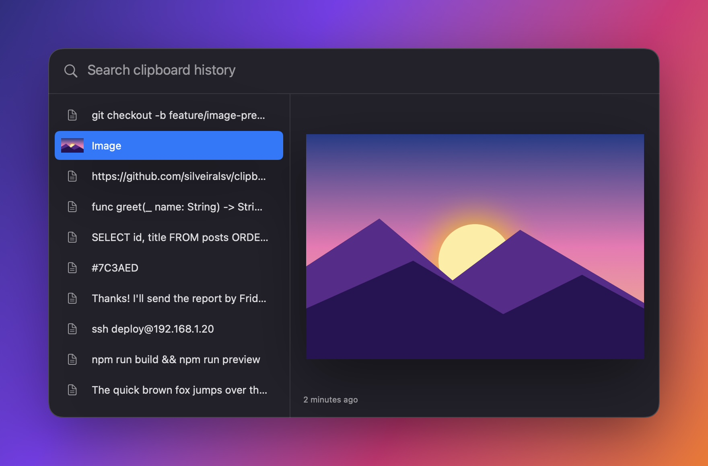

<p align="center">
  
</p>

<h1 align="center">Clipboard Hero</h1>

<p align="center">
  A tiny, native clipboard history for your Mac.<br>
  Press <kbd>⌥</kbd> <kbd>Space</kbd>, find anything you copied, press <kbd>Return</kbd>.
</p>

<p align="center">
  <a href="https://github.com/silveiralsv/clipboard-hero/releases/latest"></a>
  
  
  
  <a href="LICENSE"></a>
</p>

<p align="center">
  
</p>

## Why Clipboard Hero

- **Native and light.** Built with Swift, AppKit and SwiftUI. No Electron, no web view, no dependencies. About 13 MB of memory and ~0% CPU when idle, and the app is under 1 MB.
- **Text and images.** Everything you copy is saved, newest first. Images show a preview.
- **Spotlight-style search.** A global hotkey opens a floating search panel over any app.
- **Lives in the menu bar.** No Dock icon. The menu shows your last 5 copies.
- **Private.** History never leaves your Mac. Items that password managers mark as concealed (1Password and others) are never saved.

## Usage

| Keys | Action |
| --- | --- |
| <kbd>⌥</kbd> <kbd>Space</kbd> | Open or close the search panel |
| Type | Filter text items |
| <kbd>↑</kbd> <kbd>↓</kbd> | Move the selection |
| <kbd>Return</kbd> | Copy the selected item and close |
| <kbd>Esc</kbd> | Close |

Clicking an item also copies it. Then paste it anywhere with <kbd>⌘</kbd> <kbd>V</kbd>.

The menu bar icon gives you:

- your last 5 copies (click one to copy it again)
- **Search History…**
- **Settings…** <kbd>⌘</kbd> <kbd>,</kbd>
- the app version
- **Quit**

### Settings

- **Open search:** click the button and press a new shortcut. It must use <kbd>⌘</kbd>, <kbd>⌥</kbd> or <kbd>⌃</kbd>.
- **Keep last:** 100, 250, 500 or 1000 items.
- **Launch at login.**
- **Clear History.**

Tip: open Clipboard Hero again from Finder or Spotlight to show Settings.

## Install

1. Download [`ClipboardHero.zip`](https://github.com/silveiralsv/clipboard-hero/releases/latest/download/ClipboardHero.zip) from the [latest release](https://github.com/silveiralsv/clipboard-hero/releases/latest).
2. Unzip it and move `ClipboardHero.app` to `/Applications`.
3. Open it. The icon appears in the menu bar.

> [!NOTE]
> The app is not notarized by Apple, so macOS blocks the first launch with "Apple could not verify…". Click **Done** (not "Move to Trash"), then allow it once with:
>
> ```sh
> xattr -dr com.apple.quarantine /Applications/ClipboardHero.app
> ```
>
> Or, without the terminal: open **System Settings › Privacy & Security**, scroll down and click **Open Anyway** next to ClipboardHero.

## Build from source

You need macOS 14+ on Apple Silicon and the Xcode Command Line Tools (`xcode-select --install`). Full Xcode is not required.

```sh
git clone https://github.com/silveiralsv/clipboard-hero.git
cd clipboard-hero
./scripts/bundle.sh
open build/ClipboardHero.app
```

Run the tests with `./scripts/test.sh`.

## Where your data lives

History is stored in `~/Library/Application Support/ClipboardHero/`: `history.json` for the list and `images/` for copied images. Use **Clear History** in Settings, or delete that folder, to remove everything.

## License

[MIT](LICENSE)
